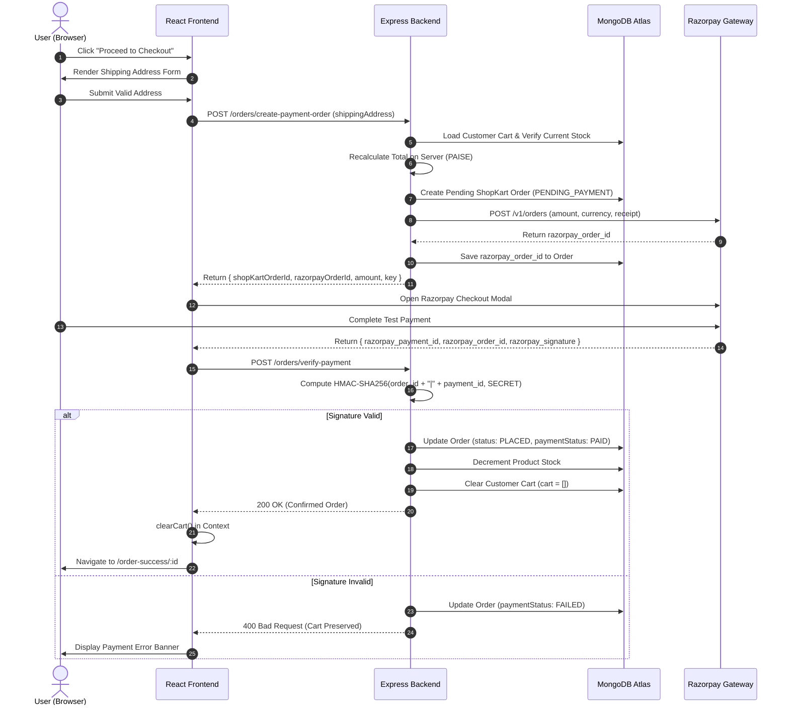

# 🛒 ShopKart — Full-Stack E-Commerce Platform

[](https://nodejs.org/)
[](https://expressjs.com/)
[](https://react.dev/)
[](https://www.mongodb.com/)
[](https://razorpay.com/)
[](https://vitejs.dev/)
[]()
[]()

A complete, production-ready MERN e-commerce web application with end-to-end shopping journeys: customer authentication with HttpOnly cookies, dynamic catalog discovery with real-time regex search, user-specific wishlist references, live shopping cart with stock limits, and Razorpay Standard Checkout with cryptographic payment signature verification.

---

## 📑 Table of Contents

- [Architectural Overview & Engineering Sequence](#-architectural-overview--engineering-sequence)
- [Key Features](#-key-features)
- [System Architecture & Flow](#-system-architecture--flow)
- [API Contract & Specifications](#-api-contract--specifications)
- [Repository Structure](#-repository-structure)
- [Environment Variables](#-environment-variables)
- [Local Installation & Setup](#-local-installation--setup)
- [Postman API Testing](#-postman-api-testing)
- [Deployment Guide](#-deployment-guide)
  - [Frontend on Vercel + Backend on Render](#option-a-separate-frontend-vercel--backend-render-recommended)
  - [Unified Deployment on Render](#option-b-unified-single-service-deployment-on-render)
- [Security & Architecture Decisions](#-security--architecture-decisions)
- [License](#-license)

---

## 🏛️ Architectural Overview & Engineering Sequence

ShopKart is structured across six milestone engineering labs representing the full lifecycle of a commercial web application:

| Lab | Milestone | Core Engineering Focus |
|:---:|---|---|
| **Lab 01** | **Server Architecture & Database** | Express server setup, MongoDB Atlas connection with in-memory fallback, and automated product catalog seeder. |
| **Lab 02** | **Customer Authentication** | Customer registration & login, password hashing with `bcryptjs`, JWT issuing in HttpOnly secure cookies, and auth route protection. |
| **Lab 03** | **Product Discovery & Catalog** | Multi-category filtering, case-insensitive regex search, price-based sorting, stock tracking, and dedicated product details view. |
| **Lab 04** | **Wishlist Architecture** | ObjectId referencing inside Customer documents, MongoDB `.populate()`, duplicate conflict prevention (`409 Conflict`), and toggle operations. |
| **Lab 05** | **Shopping Cart State** | Quantity management, server-side stock boundary checks, live cart mutations, dynamic derived calculations (`totalItems`, `subtotal`, `grandTotal`), and free shipping thresholds. |
| **Lab 06** | **Checkout & Razorpay Payment** | Multi-field shipping form validation, server-side price recalculation, pending order snapshots, Razorpay Standard Checkout modal, cryptographic HMAC-SHA256 signature verification, post-payment cart clearing, and order status lifecycle. |

---

## ✨ Key Features

- **🛡️ Secure Authentication**: Passwords hashed with salt rounds via `bcryptjs`. JWT tokens stored in `HttpOnly`, `SameSite` cookies with Bearer header fallback for cross-domain resilience.
- **🔍 Real-Time Catalog Discovery**: Filter products by category (Electronics, Fashion, Books, Home), search by keyword using regex, and sort by price ascending/descending.
- **❤️ Persistent Wishlist**: Add/remove products with instant visual feedback; prevents duplicate entries using database-level uniqueness validation.
- **🛒 Dynamic Shopping Cart**: Client state synchronizes instantly with the backend. Real-time stock enforcement prevents selecting quantities exceeding inventory.
- **💳 Razorpay Standard Web Checkout**:
  - Backend creates a pending ShopKart order and Razorpay order in paise.
  - Razorpay checkout iframe triggers seamlessly from React.
  - Server recalculates total amounts independently of frontend input.
  - Cryptographic HMAC-SHA256 payment signature verification protects against client-side tampering.
  - User cart is safely cleared **only after** signature verification succeeds.
- **📦 Order History & Snapshots**: Orders capture an immutable snapshot of product details (name, price, quantity, image) so future catalog price changes never alter historical purchase records.
- **🎨 Minimalist Monochromatic UI**: Sleek, high-contrast black, white, and metallic grey aesthetic designed in pure Vanilla CSS with glassmorphism and micro-animations.

---

## 🔄 System Architecture & Flow

### Checkout & Payment Lifecycle



---

## 📡 API Contract & Specifications

All API endpoints are available at root `/` and `/api/` prefixes.

### 1. Authentication (`/customers`)
| Method | Endpoint | Auth | Description |
|---|---|:---:|---|
| `POST` | `/customers/register` | ❌ | Register new customer (`fullName`, `email`, `password`, `phone`) |
| `POST` | `/customers/login` | ❌ | Authenticate customer & set HttpOnly JWT cookie |
| `GET` | `/customers/me` | ✅ | Fetch authenticated customer profile |
| `POST` | `/customers/logout` | ✅ | Clear customer JWT session cookie |
| `PATCH`| `/customers/change-password` | ✅ | Change customer password (`oldPassword`, `newPassword`) |

### 2. Product Catalog (`/products`)
| Method | Endpoint | Auth | Description |
|---|---|:---:|---|
| `GET` | `/products` | ❌ | List products with query filters: `?category=`, `?search=`, `?sort=price_asc\|price_desc` |
| `GET` | `/products/:id` | ❌ | Retrieve detailed product information by ID |
| `POST` | `/products` | ❌ | Create new product (`name`, `price`, `description`, `category`, `image`, `stock`) |

### 3. Wishlist (`/wishlist`)
| Method | Endpoint | Auth | Description |
|---|---|:---:|---|
| `GET` | `/wishlist` | ✅ | Get populated wishlist items for the logged-in customer |
| `POST` | `/wishlist/:productId` | ✅ | Add product to wishlist (returns `409 Conflict` if duplicate) |
| `DELETE`| `/wishlist/:productId` | ✅ | Remove product from wishlist |
| `PATCH`| `/wishlist/:productId/toggle`| ✅ | Toggle wishlist presence (adds if missing, removes if present) |

### 4. Shopping Cart (`/cart`)
| Method | Endpoint | Auth | Description |
|---|---|:---:|---|
| `GET` | `/cart` | ✅ | Get current customer's cart populated with live product details |
| `POST` | `/cart/:productId` | ✅ | Add item or increment quantity (validates stock availability) |
| `PATCH`| `/cart/:productId` | ✅ | Update item quantity (`{ quantity: number }`) |
| `DELETE`| `/cart/:productId` | ✅ | Remove item from cart |

### 5. Orders & Payments (`/orders`)
| Method | Endpoint | Auth | Description |
|---|---|:---:|---|
| `POST` | `/orders/create-payment-order` | ✅ | Validate cart, check stock, compute total, create pending order and Razorpay order |
| `POST` | `/orders/verify-payment` | ✅ | Verify HMAC-SHA256 signature, mark PAID, decrement stock & clear cart |
| `GET` | `/orders` | ✅ | Retrieve order history for authenticated user (newest first) |
| `GET` | `/orders/:id` | ✅ | Retrieve single order details (ownership enforced) |
| `PATCH`| `/orders/:id/status` | ✅ | Update order status (`PLACED` ➔ `CONFIRMED` ➔ `SHIPPED` ➔ `DELIVERED`) |

---

## 📂 Repository Structure

```text
Shopkart/
├── backend/
│   ├── config/
│   │   ├── db.js                 # MongoDB connection & in-memory fallback
│   │   └── razorpay.js           # Razorpay SDK initialization
│   ├── controllers/
│   │   ├── customer.controller.js# Authentication & user profile handlers
│   │   ├── product.controller.js # Catalog discovery, search & filtering
│   │   ├── wishlist.controller.js# Wishlist operations
│   │   ├── cart.controller.js    # Cart management & stock checks
│   │   └── order.controller.js   # Order creation, payments & signature verification
│   ├── middlewares/
│   │   └── auth.middleware.js    # JWT verification & customer context
│   ├── models/
│   │   ├── customer.model.js     # User schema with cart and wishlist references
│   │   ├── product.model.js      # Product schema
│   │   └── order.model.js        # Order schema snapshotting items & Razorpay IDs
│   ├── routes/                   # Route handlers for each domain
│   ├── utils/
│   │   └── generateToken.js      # JWT generator with cross-domain cookie options
│   ├── seedProducts.js           # Catalog database seeder
│   ├── .env.example              # Backend environment template
│   ├── .gitignore                # Backend ignore rules
│   ├── package.json              # Backend dependencies & production scripts
│   └── index.js                  # Main server entrypoint
├── frontend/
│   ├── public/
│   │   └── _redirects            # Netlify SPA routing rules
│   ├── src/
│   │   ├── components/           # Navbar, ProductCard, CartItem, ProtectedRoute, etc.
│   │   ├── context/              # AuthContext and CartContext state providers
│   │   ├── pages/                # Products, ProductDetails, Cart, Checkout, Orders, Home
│   │   ├── services/
│   │   │   └── api.js            # Axios client with interceptors for Bearer auth
│   │   ├── utils/
│   │   │   └── loadRazorpay.js   # Razorpay checkout script loader
│   │   ├── App.jsx               # Route mapping
│   │   ├── index.css             # Monochromatic design system tokens
│   │   └── main.jsx              # React DOM entry
│   ├── .env.example              # Frontend environment template
│   ├── .gitignore                # Frontend ignore rules
│   ├── vercel.json               # Vercel SPA rewrite rule
│   ├── vite.config.js            # Vite configuration
│   └── package.json              # Frontend dependencies
├── Shopkart_Postman_Collection.json # Postman collection for all lab endpoints
├── package.json                  # Root monorepo orchestration scripts
├── .gitignore                    # Root repository ignore rules
└── README.md
```

---

## ⚙️ Environment Variables

### Backend Configuration (`backend/.env`)

```env
PORT=5000
NODE_ENV=production
MONGO_URI=mongodb+srv://<username>:<password>@cluster0.mongodb.net/shopkart?retryWrites=true&w=majority
JWT_SECRET=your_super_secret_jwt_key
CLIENT_URL=http://localhost:5173
RAZORPAY_KEY_ID=rzp_test_your_key_id
RAZORPAY_KEY_SECRET=your_razorpay_key_secret
```

### Frontend Configuration (`frontend/.env`)

```env
VITE_RAZORPAY_KEY_ID=rzp_test_your_key_id
# Leave empty for local development (defaults to localhost:5000)
# For production deployment, set to your backend service URL:
VITE_API_URL=https://your-shopkart-backend.onrender.com
```

---

## 💻 Local Installation & Setup

### Prerequisites
- Node.js (v18 or higher)
- npm or yarn
- MongoDB Atlas cluster URI (or local MongoDB daemon)

### 1. Clone the repository
```bash
git clone https://github.com/sakethverse-dev/LAB-PROJECT.git
cd LAB-PROJECT
```

### 2. Install dependencies
```bash
# Install backend dependencies
cd backend
npm install

# Install frontend dependencies
cd ../frontend
npm install

# Return to root directory
cd ..
```

### 3. Setup Environment Variables
- Copy `backend/.env.example` to `backend/.env` and insert your credentials.
- Copy `frontend/.env.example` to `frontend/.env` and insert your Razorpay Key ID.

### 4. Seed the Database
```bash
npm run seed
```

### 5. Launch Development Servers
```bash
# Run both servers concurrently from root:
npm run dev

# Or run separately in two terminals:
# Terminal 1: Backend
npm run backend

# Terminal 2: Frontend
npm run frontend
```
- Frontend: `http://localhost:5173`
- Backend API: `http://localhost:5000`

---

## 🧪 Postman API Testing

An official Postman collection is included directly in the root directory: [`Shopkart_Postman_Collection.json`](./Shopkart_Postman_Collection.json).

### How to use:
1. Open Postman.
2. Click **Import** and select `Shopkart_Postman_Collection.json`.
3. Set the `baseUrl` collection variable (defaults to `http://localhost:5000`).
4. Execute tests sequentially:
   - **1. Server Health**: GET `/api/health`
   - **2. Customer Auth**: POST `/customers/register` ➔ POST `/customers/login`
   - **3. Catalog Discovery**: GET `/products` ➔ GET `/products/:id`
   - **4. Wishlist**: POST `/wishlist/:productId` ➔ GET `/wishlist`
   - **5. Shopping Cart**: POST `/cart/:productId` ➔ PATCH `/cart/:productId` ➔ GET `/cart`
   - **6. Orders & Razorpay Checkout**: POST `/orders/create-payment-order` ➔ POST `/orders/verify-payment` ➔ GET `/orders`

---

## 🌐 Deployment Guide

### Option A: Separate Frontend (Vercel) + Backend (Render) *(Recommended)*

#### 1. Deploy the Backend to [Render](https://render.com)
1. Log into Render and click **New +** ➔ **Web Service**.
2. Connect your GitHub repository (`LAB-PROJECT`).
3. Set the build parameters:
   - **Root Directory**: `backend`
   - **Build Command**: `npm install`
   - **Start Command**: `npm start`
4. In the **Environment Variables** panel, add:
   - `NODE_ENV`: `production`
   - `MONGO_URI`: `your_mongodb_atlas_connection_string`
   - `JWT_SECRET`: `your_secure_random_secret`
   - `RAZORPAY_KEY_ID`: `your_razorpay_key_id`
   - `RAZORPAY_KEY_SECRET`: `your_razorpay_key_secret`
   - `CLIENT_URL`: `https://your-frontend.vercel.app` *(update once frontend is live)*
5. Click **Deploy Web Service** and copy your backend URL (e.g. `https://shopkart-backend.onrender.com`).

#### 2. Deploy the Frontend to [Vercel](https://vercel.com)
1. Log into Vercel and click **Add New...** ➔ **Project**.
2. Select your `LAB-PROJECT` repository.
3. Configure project settings:
   - **Root Directory**: `frontend`
   - **Framework Preset**: `Vite` (auto-detected)
4. In the **Environment Variables** panel, add:
   - `VITE_API_URL`: `https://your-shopkart-backend.onrender.com`
   - `VITE_RAZORPAY_KEY_ID`: `your_razorpay_key_id`
5. Click **Deploy**.
6. Once deployed, copy your production Vercel domain and update the `CLIENT_URL` in your Render backend settings.

---

### Option B: Unified Single-Service Deployment on Render

ShopKart includes a built-in static handler in `backend/index.js` that automatically serves `frontend/dist` in production if built together on a single server.

1. Create a **Web Service** on Render with Root Directory set to root (`.`).
2. **Build Command**: `npm run build`
3. **Start Command**: `npm start`
4. Set Environment Variables:
   - `NODE_ENV`: `production`
   - `MONGO_URI`, `JWT_SECRET`, `RAZORPAY_KEY_ID`, `RAZORPAY_KEY_SECRET`
   - `CLIENT_URL`: Leave empty or set to your Render domain.

---

## 🔒 Security & Architecture Decisions

1. **Why is the Razorpay Key Secret never exposed to the frontend?**
   - The `RAZORPAY_KEY_SECRET` is used exclusively on the server to compute the HMAC-SHA256 hash. Exposing the secret to the browser would allow any user to forge valid payment signatures and mark orders as paid without paying.
2. **Why does the server recalculate the order total?**
   - Frontend client totals cannot be trusted. Malicious users can modify request payloads to send `{ totalAmount: 1 }`. The server validates item quantities against live database product prices.
3. **Why snapshot product names and prices into the Order model?**
   - An order represents an immutable contract of purchase. If a merchant updates a product's price or description next month, past customer orders must retain the exact historical price paid.
4. **Why is the cart cleared only after signature verification?**
   - If a payment is declined, cancelled, or fails verification, the user should not lose their selected cart items. The cart is only reset when the order transitions to `PAID`.
5. **Why use dual-token handling (HttpOnly Cookie + Bearer Authorization header)?**
   - Modern browsers frequently restrict third-party cross-origin cookies. By combining HttpOnly cookies with an Axios request interceptor fallback sending `Authorization: Bearer <token>`, the application remains 100% resilient across cross-domain deployments (e.g. Vercel frontend talking to Render backend).

---

## 📄 License

This project is open-source and available under the [MIT License](LICENSE).
